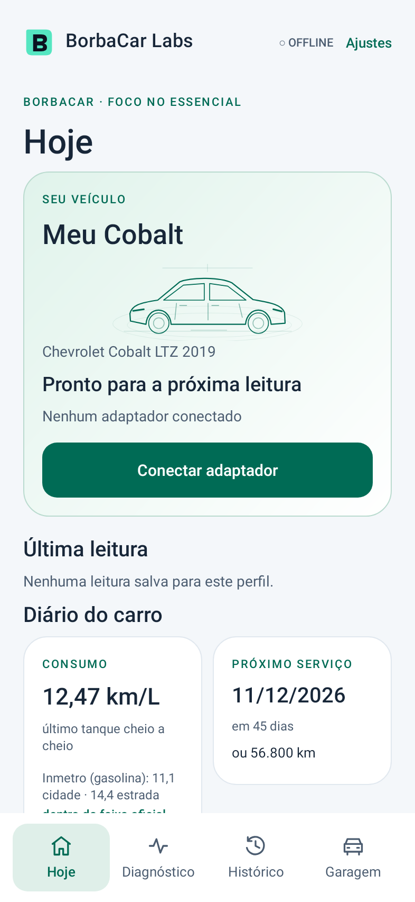
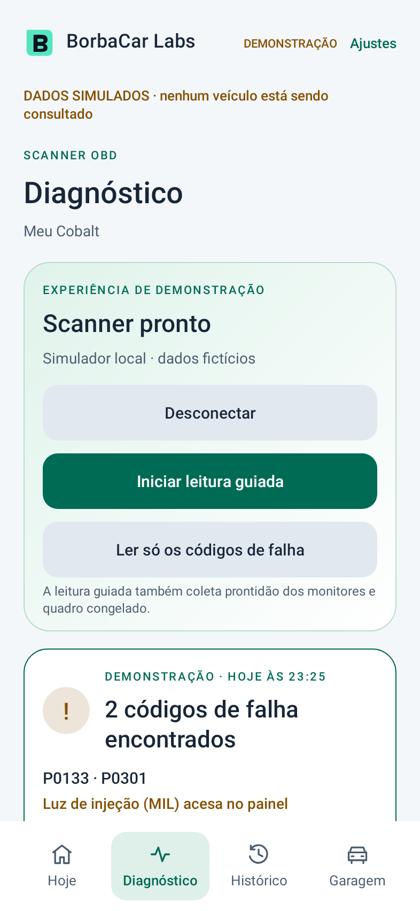
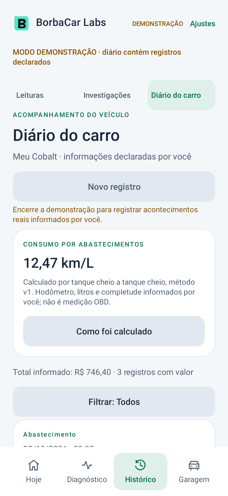
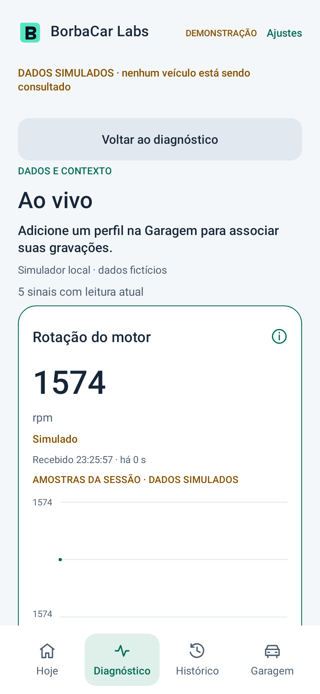
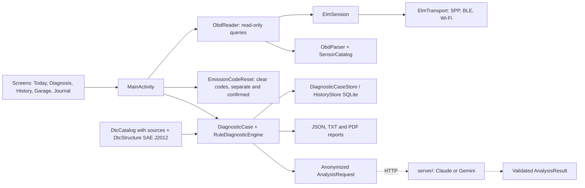

<a name="readme-top"></a>

<div align="center">

<h1 align="center">BorbaCar Labs</h1>

<br>

# Welcome to the BorbaCar Labs repository

---

<div align="center">

[![CI Status][ci-shield]][ci-link]
[![Release][release-shield]][release-link]
[![Project Type][type-shield]][type-link]
[![Java][java-shield]][java-link]
[![Android][android-shield]][android-link]

</div>

[ci-shield]: https://github.com/YagoBorba/BorbaCarLabs/actions/workflows/android.yml/badge.svg?branch=develop
[ci-link]: https://github.com/YagoBorba/BorbaCarLabs/actions/workflows/android.yml
[release-shield]: https://img.shields.io/badge/Release-1.0.2-2EA44F?style=flat-square&labelColor=black
[release-link]: https://github.com/YagoBorba/BorbaCarLabs/releases
[type-shield]: https://img.shields.io/badge/Project-Android%20App-0A66C2?style=flat-square&labelColor=black
[type-link]: https://github.com/YagoBorba/BorbaCarLabs
[java-shield]: https://img.shields.io/badge/Java-17-ED8B00?style=flat-square&logo=openjdk&logoColor=white&labelColor=black
[java-link]: https://openjdk.org/
[android-shield]: https://img.shields.io/badge/Android-8.0%2B%20(API%2026)-3DDC84?style=flat-square&logo=android&logoColor=3DDC84&labelColor=black
[android-link]: https://developer.android.com/

</br>

</div>

## About the Project

> [!IMPORTANT]
> BorbaCar Labs is an Android OBD-II diagnostic app written in Java. It reads the car through an ELM327 adapter, explains what it found in plain language and keeps a traceable record of every reading, so a diagnosis can always be checked back against its evidence.

The project started as an academic work on vehicle diagnostics. Instead of only listing trouble codes, the app turns a reading into an **investigation**: declared symptoms, readiness monitors, freeze frame and live data feed an offline rules engine that suggests what to check next. Every fact in a report points to the evidence and the source it came from, and anything simulated is always labeled as such. The interface is in Brazilian Portuguese.

<div align="center">

| Today | Diagnosis | Journal | Live |
|---|---|---|---|
|  |  |  |  |

<sub>Screenshots generated by the Robolectric screen tests (`ScreensTest`) with the real Activity and demo data.</sub>

</div>

## What Can BorbaCar Labs Do?

- **Adapter Connection:**
    Connects to ELM327 adapters over Bluetooth Classic, Bluetooth Low Energy or Wi-Fi, with automatic protocol detection.

- **Guided Reading:**
    Reads stored, pending and permanent trouble codes, the check engine light, readiness monitors and freeze frame, and ends with a clear verdict ("No trouble codes", "2 codes found").

- **Live Data:**
    Up to six sensors at once with status and timestamp for every sample, an RPM chart and CSV recording.

- **Investigations:**
    Cases with declared symptoms, revisions, an offline rules engine, a verification checklist and traceable JSON, TXT and PDF reports.

- **Garage & Vehicle Catalog:**
    516 versions, 225 models and 34 brands from model year 2019, extracted from the official Inmetro PBE Veicular table with a source for every attribute.

- **Trouble Code Catalog:**
    91 generic P0 codes with meaning and source; any other code is described by its system area following SAE J2012.

- **Car Journal:**
    Fill-ups, services and symptoms, with tank-to-tank fuel economy compared to the official Inmetro figures for the selected version.

- **Maintenance Reminders:**
    Daily notification when a service logged in the journal is within 7 days or 500 km of being due.

- **AI Analysis (demo):**
    Hypotheses that cite the case evidence, through a small Node.js server that keeps the API key off the phone (Claude by default, Gemini for free testing).

- **Demo Mode:**
    Explore every screen without a car, with simulated data clearly marked.

## Under the Hood (Main Technologies)

- **[Java 17](https://openjdk.org/) & [Android SDK](https://developer.android.com/):** Native app with views built in code, min SDK 26 and target SDK 35.
- **[ELM327](https://www.elmelectronics.com/) over SPP, BLE and TCP:** Transport layer for the adapter, isolated behind `ElmTransport`.
- **[SQLite](https://developer.android.com/training/data-storage/sqlite):** Local storage for diagnostic cases and the journal; nothing leaves the device unless the user exports it.
- **[PdfDocument](https://developer.android.com/reference/android/graphics/pdf/PdfDocument):** Paginated PDF reports with sections and a simulated-data banner.
- **[JUnit 4](https://junit.org/junit4/) & [Robolectric](https://robolectric.org/):** JVM tests for the OBD stack and screen tests with the real `MainActivity`.
- **[Node.js](https://nodejs.org/):** AI proxy server with the [Anthropic](https://docs.anthropic.com/) and [Google Gen AI](https://ai.google.dev/) SDKs.
- **[GitHub Actions](https://github.com/features/actions) & [Dependabot](https://docs.github.com/en/code-security/dependabot):** Build, tests, lint, signed releases and dependency updates.

## Architecture



The rules engine and the AI never touch the transport: they receive data, not commands. Clearing trouble codes lives in its own class and always asks for confirmation.

## Getting Started

### Prerequisites

- **[JDK 17+](https://adoptium.net/)**
- **[Android SDK](https://developer.android.com/studio)** with platform 35 (Android Studio or command line tools)
- An ELM327 adapter to read a real car (optional: demo mode works without one)
- **[Node.js 20+](https://nodejs.org/)** to run the AI server (optional)

### 1. Clone the repository

```bash
git clone https://github.com/YagoBorba/BorbaCarLabs.git
cd BorbaCarLabs
```

### 2. Build the debug APK

```bash
./gradlew assembleDebug
```

The APK is written to `app/build/outputs/apk/debug/app-debug.apk`.

> [!TIP]
> The debug build uses the package `io.rea.obd.teste` and the name "BorbaCar Labs (teste)", so it installs next to the release app without touching its data and allows HTTP on the local network for the AI demo.

### 3. Run the tests

```bash
./gradlew testDebugUnitTest lintDebug
```

### 4. Start the AI server (optional)

```bash
cd server
npm ci
npm start
```

See [server/README.md](server/README.md) for the environment variables. API keys are set on the machine running the server and never stored in the app or in the repository.

### 5. Signed release

Copy `keystore.properties.example` to `keystore.properties` (ignored by Git), fill it with the app certificate and run:

```bash
./gradlew assembleRelease
```

Without that file the release APK is built unsigned.

## Quality & Tests

The CI pipeline runs on every pull request and on every push to `main` and `develop`:

```bash
./gradlew assembleDebug testDebugUnitTest lintDebug
```

- **JVM tests:** a `FakeAdapter` plays scripted ELM327 responses to cover the ELM session, OBD parser, `ObdReader`, the bundled catalogs, journal round trips, fuel economy, DTC structure, report formatting and layout, reminders and the AI contract (anonymization and rejection of invented evidence).
- **Screen tests:** Robolectric opens the real `MainActivity`, walks through every main screen and a scenario with a vehicle profile, journal and a demo reading, saving the screenshots above.
- **Lint:** no errors; the report, test results, screenshots and APK are uploaded as workflow artifacts.

Pushing a `v*` tag runs the release workflow, which tests, builds, signs and publishes the APK on the [Releases](https://github.com/YagoBorba/BorbaCarLabs/releases) page. Publishing requires these repository secrets; without any of them the workflow fails before creating the release:

| Secret | Content |
|---|---|
| `KEYSTORE_BASE64` | The keystore file encoded in Base64 |
| `KEYSTORE_PASSWORD` | Keystore password |
| `KEY_ALIAS` | Alias of the signing key |
| `KEY_PASSWORD` | Password of the signing key |

The signature is checked with `apksigner verify` before publishing. Running the workflow manually (`workflow_dispatch`) only builds the APK as a workflow artifact, unsigned when the secrets are missing, and never creates a release.

## Project Structure

```text
app/src/main/java/io/rea/obd/
    ai/             AI request, response contract and validation
    application/    guided reading controller
    diagnostics/    cases, rules engine, demo scenarios and formatting
    history/        case store (SQLite), reading history and JSON codecs
    journal/        fill-ups, services, fuel economy and reminders
    knowledge/      trouble code catalog and SAE J2012 structure
    model/          data origin and fact provenance
    telemetry/      live samples and dashboard state
    ui/             screens, theme and motion
    vehicle/        profiles and the Inmetro 2019 catalog
    MainActivity.java, ObdReader.java, ElmSession.java, Transports.java,
    ReportWriter.java, ReportLayout.java, ...

app/src/test/       JVM and Robolectric tests
server/             AI proxy server (Node.js)
tools/              catalog generation from the official sources
docs/               demo script, privacy notice, screenshots and project history
```

## Limitations

- Generic OBD-II emissions diagnostics only; ABS, airbag and manufacturer-specific modules are not read.
- Code meanings only for codes in the catalog; other codes show their system area with no presumed cause.
- The AI suggests possibilities, not a diagnosis; its answer is not saved in the case and never changes rules or reports.
- The AI server is meant for local network demos (HTTP, daily counter kept in memory).
- Not yet verified on a real car and adapter, or PDF rendering on a physical device.

## Documentation

| Document | Content |
|---|---|
| [CHANGELOG.md](CHANGELOG.md) | Version history |
| [docs/DEMONSTRACAO.md](docs/DEMONSTRACAO.md) | Demo script |
| [docs/PRIVACIDADE.md](docs/PRIVACIDADE.md) | Privacy notice (LGPD) |
| [docs/historico/](docs/historico/README.md) | Master plan, architecture, contracts, catalogs and validation of every version since 0.3.0 |
| [server/README.md](server/README.md) | AI server |
| [tools/README.md](tools/README.md) | Catalog generation from the sources |

Project documents are written in Brazilian Portuguese.

## Contributing

This project follows **GitFlow** and **Conventional Commits**. Please read the [Contributing Guide](CONTRIBUTING.md) and the [Commit Convention](.github/COMMIT_CONVENTION.md).

1. Create your branch from `develop` (`feature/...`, `fix/...` or `docs/...`).
2. Commit your changes following the commit convention.
3. Push your branch.
4. Open a Pull Request to `develop`.

## License

No `LICENSE` file is currently present in this repository. All rights reserved until a license is chosen.

## Contact

- Email: yagoaborba@hotmail.com
- LinkedIn: https://www.linkedin.com/in/yagoborba/

---

<div align="right">
    <a href="#readme-top">Back to Top</a>
</div>
