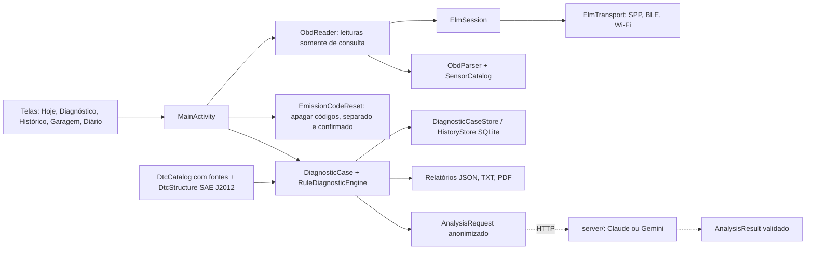

# BorbaCar Labs

Leitor de diagnóstico OBD2 para Android, em Java, com caderno do carro e análise por IA opcional.
Projeto acadêmico, versão 1.0.0 (pacote `io.rea.obd`).

| Hoje | Diagnóstico | Diário | Ao vivo |
|---|---|---|---|
|  |  |  |  |

<sub>Capturas geradas pelos testes Robolectric (`ScreensTest`) com a Activity real e dados de demonstração.</sub>

## O que o app faz

- **Conexão** com adaptadores ELM327 por Bluetooth clássico, BLE ou Wi-Fi, sem precisar conhecer o protocolo do carro.
- **Leitura guiada**: códigos de falha armazenados, pendentes e permanentes, luz de injeção, prontidão
  dos monitores e quadro congelado; veredito claro ("Nenhum código de falha", "2 códigos encontrados").
- **Ao vivo**: até seis sensores com estado e horário de cada amostra, gráfico de RPM e gravação CSV.
- **Investigações**: caso com sintomas declarados, revisões, motor de regras offline, roteiro de
  verificação e relatórios JSON, TXT e PDF rastreáveis (cada fato aponta evidência e fonte).
- **Garagem** com catálogo factual de 516 versões, 225 modelos e 34 marcas do ano-modelo 2019 (tabela PBE Veicular do Inmetro, fonte por atributo).
- **Catálogo de códigos** `generic-dtc-2`: 91 códigos genéricos P0 com significado e fonte; para os demais, a área do sistema pela estrutura SAE J2012.
- **Diário**: abastecimentos, serviços e sintomas; consumo cheio a cheio comparado ao **consumo oficial do Inmetro** da versão.
- **Lembretes de manutenção**: notificação diária quando um serviço registrado no Diário está a 7 dias ou 500 km de vencer.
- **Análise por IA (demonstração)**: hipóteses citando as evidências do caso, via servidor próprio.
- **Modo demonstração** sem carro, com dados simulados sempre marcados como tal.

## Arquitetura



O motor de regras e a IA não têm acesso ao transporte: recebem dados, não comandos.

## Estado do plano

| Módulo do plano | Situação |
|---|---|
| 0 · Auditoria | Feita em 19/10; leitura no veículo real ainda pendente |
| 1 · Veículos | Perfis com proveniência por atributo, catálogo MY19, migração não destrutiva |
| 2 · Conhecimento | Catálogos `generic-dtc-1` e `generic-dtc-2` com fontes; estrutura SAE J2012 para qualquer código |
| 3 · OBD/telemetria | Amostras tipadas, sessões, leitura guiada, falhas de transporte tratadas |
| 4 · Painel | Ao vivo com estados, gráfico e CSV |
| 5 · Diagnóstico | Casos, regras `investigation-1`, veredito e roteiro |
| 6 · IA | Demonstração com contrato validado e servidor intermediário (0.7.0) |
| 7 · Relatório e demonstração | PDF com seções, paginação e faixa de dados simulados; roteiro em `docs/` |
| 8 · Histórico/relatórios | Histórico por veículo, comparação de leituras, exportações |
| 9 · Laboratório | Fora do escopo do MVP |

## Como rodar

```bash
./gradlew assembleDebug        # APK de teste: app/build/outputs/apk/debug/app-debug.apk
./gradlew testDebugUnitTest    # 62 testes JVM, sem emulador
```

Gradle 8.11.1, AGP 8.7.3, JDK 17+. O build de debug usa o pacote `io.rea.obd.teste` e o nome
"BorbaCar Labs (teste)": instala ao lado do app publicado sem tocar nos dados dele e permite HTTP
na rede local para a demonstração da IA. O release mantém `io.rea.obd` e exige o certificado original
para atualizar o app instalado.

Servidor de IA: ver [server/README.md](server/README.md) (Claude por padrão; Gemini gratuito para testes).

## Evidências

- **Testes JVM** (`app/src/test`): `FakeAdapter` simula um ELM327 por comandos roteirizados. Cobrem
  sessão ELM, parser OBD, `ObdReader` (leitura ao vivo e complemento), catálogo embarcado real,
  ida e volta de leitura/complemento/diário, consumo, estrutura de DTC, formatação, contrato da IA
  (anonimização e rejeição de evidência inventada), layout do PDF, lembretes e consumo oficial.
- **Testes de tela** (Robolectric 4.14, SDK 35): abrem a `MainActivity` real, percorrem as telas vazias e
  um cenário com perfil, Diário e leitura de demonstração, e salvam capturas; a notificação de
  lembrete é verificada no `NotificationManager`.
- **Integração contínua**: `.github/workflows/android.yml` compila, roda os testes e o lint e publica APK,
  relatórios e capturas a cada push.
- **Teste real da IA** (26 e 27/10): caso de demonstração pelo código do app até o Gemini e de volta,
  validado em ~3 s.
- **Não verificado**: leitura em veículo e adaptador reais; renderização do PDF em aparelho
  (o `PdfDocument` do Android não roda em teste JVM; o layout é testado à parte em `ReportLayout`).

## Limitações

- Diagnóstico de emissões OBD2 genérico; ABS, airbag e módulos específicos não são lidos.
- Significados de códigos só para os do catálogo; os demais mostram a área do sistema, sem causa presumida.
- A IA propõe possibilidades, não diagnóstico; não é salva no caso nem altera regras e relatórios.
- Servidor de IA feito para demonstração em rede local (HTTP, contador diário em memória).

## Documentação

| Documento | Conteúdo |
|---|---|
| [CHANGELOG.md](CHANGELOG.md) | Histórico de versões |
| [docs/DEMONSTRACAO.md](docs/DEMONSTRACAO.md) | Roteiro de apresentação |
| [docs/PRIVACIDADE.md](docs/PRIVACIDADE.md) | Aviso de privacidade (LGPD) |
| [docs/historico/](docs/historico/README.md) | Plano mestre, arquitetura, contratos, catálogos e validações de cada versão desde a 0.3.0 |
| [server/README.md](server/README.md) | Servidor de IA |
| [tools/README.md](tools/README.md) | Geração dos catálogos a partir das fontes |

## Versão oficial assinada

Copie `keystore.properties.example` para `keystore.properties` (fora do Git), preencha com o
certificado do app e rode `./gradlew assembleRelease`. Sem esse arquivo o release sai sem assinatura.
Pelo GitHub, um tag `v*` dispara o workflow de release, que assina o APK quando os segredos
`KEYSTORE_BASE64`, `KEYSTORE_PASSWORD`, `KEY_ALIAS` e `KEY_PASSWORD` estão configurados.
