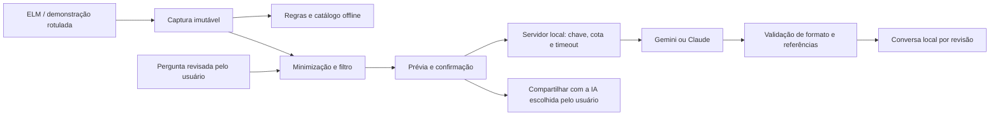

# BorbaCar Labs — assistente explicável para investigações OBD-II

## Objetivo e pergunta de pesquisa

Construir e avaliar um aplicativo Android que organiza evidências OBD-II e permite ao usuário perguntar a um modelo de linguagem sobre uma captura, distinguindo medições, sintomas declarados e hipóteses.

Pergunta: uma conversa contextualizada e acompanhada de referências ajuda um usuário iniciante a compreender a leitura e preparar uma conversa com a oficina, sem transformar possibilidades em diagnóstico confirmado?

O produto entrega leitura, histórico, diário, referências e conversa. O experimento acadêmico avalia compreensão, rastreabilidade e capacidade de reconhecer informação insuficiente. Quantidade de funcionalidades ou testes não demonstra precisão mecânica.

## Onde a IA participa



O modelo recebe dados estruturados e até três resumos recentes da mesma conversa. Cada revisão tem sua própria conversa, com até oito interações guardadas e limite de trinta conversas no aparelho. A pergunta passa pelo filtro de identificadores. O usuário revisa o JSON antes de cada envio, incluindo o contexto anterior. Respostas não alteram a captura, o motor de regras ou o relatório técnico.

O botão **Usar minha IA** compartilha um prompt com os mesmos dados revisados pelo seletor do Android. O usuário escolhe um aplicativo e pode colar a pergunta no serviço de sua preferência. Isso não autentica automaticamente uma conta de chat, não utiliza a assinatura pessoal como API e não importa a resposta de volta ao aplicativo. Os controles e a política do serviço escolhido passam a valer após compartilhar.

O **Guia offline · sem IA** usa catálogo e regras. É uma alternativa de apresentação sem rede e nunca deve ser apresentada como uma chamada a um modelo.

## Preparação mais simples

No Windows, na raiz do repositório:

```powershell
./start-ai.ps1
```

Na primeira execução, escolha Gemini ou Claude e informe uma chave de API do próprio provedor. O assistente grava `server/.env`, excluído do Git. O token do app é gerado automaticamente. Um modelo pode ser informado; se omitido, vale o padrão configurado no servidor. Disponibilidade, preço e cotas dependem do provedor e da conta; não há promessa de gratuidade.

O script instala as dependências se necessário e inicia o servidor. O terminal mostra um convite `http://IP:8787/#TOKEN`. No celular e computador na mesma rede, abra **Ajustes → Análise por IA → Convite do servidor**, cole o convite e toque em **Salvar e testar conexão**. O convite é uma credencial: não publique seu conteúdo em slides, capturas ou no Git.

O teste verifica o servidor e o token, sem chamar o provedor. Uma conexão bem-sucedida não confirma a validade da chave do provedor; isso é verificado na primeira análise. Para reconfigurar, use `./start-ai.ps1 -Configure`. Em outros sistemas: `cd server`, `npm ci`, `npm run setup`, `npm start`.

Use a APK de teste para a apresentação na rede local: ela permite HTTP e instala separadamente da versão de release. O Android pode impedir HTTP no build de release; para hospedagem externa, é necessário HTTPS. Evite redes públicas e confirme o acesso na rede da apresentação com antecedência.

## Demonstração de cinco minutos

1. Mostre o rótulo de demonstração e explique que os dados do carro são simulados.
2. Execute uma leitura guiada e apresente os códigos, os serviços consultados e o resumo para oficina.
3. Toque em **Conversar com a IA** no resultado: a captura é guardada e reutilizada sem duplicar a investigação. Sintomas opcionais podem ser acrescentados pela ação de investigação.
4. Escolha “O que estes códigos significam em linguagem simples?”, revise os dados e envie. Mostre o nome do modelo retornado.
5. Pergunte “Quais informações faltam para investigar melhor?” e mostre as referências e os limites da resposta. Explique que a conversa mantém o contexto da mesma revisão.
6. Mostre **Usar minha IA**, sem enviar dados a outro serviço durante a apresentação se não for necessário.
7. Sem rede, use explicitamente o guia offline. Mostre um backup sendo criado; a restauração substitui registros e deve ser ensaiada somente com uma cópia de teste.

## Avaliação técnica e de IA

```powershell
./gradlew testDebugUnitTest lintDebug assembleDebug
cd server
npm test
npm run evaluate:fixtures
```

Os testes de software exercitam contratos, filtros, HTTP, falhas, armazenamento, restauração, referências, acessibilidade e regressões visuais. O provedor dos testes do servidor é falso e não chama uma IA real. As capturas automáticas também não comprovam uso em telefone físico.

Para avaliar respostas reais, inicie o servidor e, em outro terminal em `server/`, execute:

```powershell
npm run evaluate:live
```

Esse comando faz **cinco chamadas reais**, consumindo a cota ou créditos configurados, e grava `evaluation-result.json`, excluído do Git. O corpus contém falha de combustão, RPM isolado, ausência de códigos, instrução maliciosa e preparação para oficina. Todos são casos sintéticos, não um conjunto de diagnósticos confirmados.

O arquivo registra modelo, latência, resposta e critérios de revisão. Preencha manualmente os campos: afirmações sustentadas, abstenção adequada, próximo passo útil e comentários. Um especialista automotivo deve revisar afirmações mecânicas. Campos sem preenchimento significam **não avaliado**, nunca aprovação. HTTP 200 indica aceitação do contrato, não correção mecânica.

Métricas sugeridas: proporção de respostas com afirmações sem apoio, proporção de abstenções corretas em dados insuficientes, utilidade dos próximos passos e tempo de resposta. Preserve a versão do app, modelo, data e perguntas para comparação. Não atribua acurácia ou segurança de condução sem protocolo e resultados apropriados.

## Avaliação com usuários — protocolo proposto, ainda não executado

Com cinco participantes iniciantes, peça para reconhecer a demonstração, encontrar o horário da leitura, formular uma pergunta, identificar uma hipótese e produzir um resumo para oficina. Registre sucesso sem ajuda, tempo, erros e explicação em suas próprias palavras. Compare a compreensão antes e depois da explicação assistida. Não grave dados pessoais ou telemetria silenciosamente.

## Qualidade e limites

- Perguntas e respostas são notas de apoio, separadas dos fatos diagnósticos.
- Referência existente não prova que a conclusão é sustentada por ela. O contrato não substitui avaliação humana.
- O filtro remove padrões de identificadores brasileiros; nomes, endereços e formatos não reconhecidos podem permanecer na prévia.
- Não há comando de transporte acessível ao modelo. Apagar códigos permanece uma operação separada e confirmada.
- O backup lógico contém garagem, leituras, revisões de casos e diário. Exclui CSV, configurações, credenciais e conversas com IA. Valida formato, integridade e revisões; mantém cópia de desfazer e recupera uma restauração interrompida antes de abrir os dados. O checksum detecta alteração, mas não autentica o autor do arquivo. O arquivo não é criptografado.
- Hardware, PDF e seletor de documentos precisam de ensaio em telefone físico. Catálogo e código implementado não representam compatibilidade física comprovada.

## Continuidade

Antes de ampliar o catálogo ou novos módulos: executar o protocolo de usuários, revisar as respostas reais e registrar ensaios físicos. A hipótese de valor é ajudar o proprietário a entender evidências e conversar com a oficina. Retenção, disposição a pagar e benefícios mecânicos permanecem não demonstrados; monetização não é critério de sucesso deste trabalho acadêmico.
