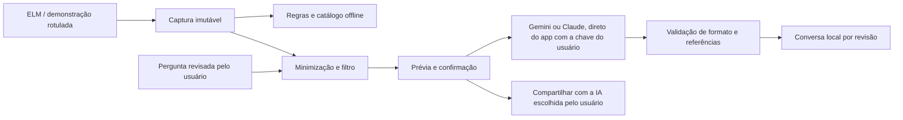

# BorbaCar Labs — assistente explicável para investigações OBD-II

## Objetivo e pergunta de pesquisa

Construir e avaliar um aplicativo Android que organiza evidências OBD-II e permite ao usuário perguntar a um modelo de linguagem sobre uma captura, distinguindo medições, sintomas declarados e hipóteses.

Pergunta: uma conversa contextualizada e acompanhada de referências ajuda um usuário iniciante a compreender a leitura e preparar uma conversa com a oficina, sem transformar possibilidades em diagnóstico confirmado?

O produto entrega leitura, histórico, diário, referências e conversa. O experimento acadêmico avalia compreensão, rastreabilidade e capacidade de reconhecer informação insuficiente. Quantidade de funcionalidades ou testes não demonstra precisão mecânica.

## Onde a IA participa



O modelo recebe dados estruturados e até três resumos recentes da mesma conversa. Cada revisão tem sua própria conversa, com até oito interações guardadas e limite de trinta conversas no aparelho. A pergunta passa pelo filtro de identificadores. O usuário revisa o JSON antes de cada envio, incluindo o contexto anterior. Respostas não alteram a captura, o motor de regras ou o relatório técnico.

As instruções do modelo, o esquema da resposta e os limites do caso ficam no próprio app (`AiPrompt`). O app recusa respostas fora do esquema ou que citem evidências não enviadas, antes de salvar.

O botão **Usar minha IA** compartilha um prompt com os mesmos dados revisados pelo seletor do Android. O usuário escolhe um aplicativo e pode colar a pergunta no serviço de sua preferência. Isso não autentica uma conta de chat, não utiliza a assinatura pessoal como API e não importa a resposta de volta ao aplicativo.

O **Guia offline · sem IA** usa catálogo e regras. É uma alternativa sem rede e nunca deve ser apresentado como uma chamada a um modelo.

## Configurar a IA

Não é preciso computador nem servidor. O celular fala direto com o provedor, pela internet dele (Wi-Fi ou dados móveis).

1. Crie uma chave de API:
   - **Gemini (recomendado para a apresentação):** [Google AI Studio](https://aistudio.google.com/apikey), entre com uma conta Google e crie a chave. Costuma haver uma cota gratuita; no plano gratuito o Google pode usar os dados enviados para melhorar os produtos dele.
   - **Claude:** [Claude Console](https://platform.claude.com/settings/keys). A API usa créditos pré-pagos; a assinatura do app Claude não vale como chave de API.
2. No app: **Ajustes › Análise por IA**, escolha o provedor, cole a chave e toque em **Salvar e testar chave**. O teste confere a chave e o modelo sem gerar texto, então não consome créditos.
3. Pronto: em uma leitura ou investigação, toque em **Conversar com a IA**.

A chave fica criptografada no celular (Android Keystore) e só é enviada ao provedor escolhido. Em **Avançado** dá para trocar o modelo; vazio usa `gemini-3.5-flash-lite` ou `claude-sonnet-5-5`. Chaves do Claude sem workspace aceitam o ID do workspace.

Disponibilidade, preço e cotas dependem do provedor e da conta; não há promessa de gratuidade.

## Demonstração sugerida

1. Mostre o rótulo de demonstração e explique que os dados do carro são simulados.
2. Execute uma leitura guiada e apresente os códigos, os serviços consultados e o resumo para oficina.
3. Toque em **Conversar com a IA** no resultado: a captura é guardada e reutilizada sem duplicar a investigação.
4. Escolha "O que estes códigos significam em linguagem simples?", revise os dados e envie. Mostre o nome do modelo retornado.
5. Pergunte "Quais informações faltam para investigar melhor?" e mostre as referências e os limites da resposta. A conversa mantém o contexto da mesma revisão.
6. Mostre **Usar minha IA**, sem enviar dados a outro serviço se não for necessário.
7. Sem internet, use explicitamente o guia offline.

O roteiro de preparação está em [DEMONSTRACAO.md](DEMONSTRACAO.md).

## Avaliação técnica e de IA

```powershell
./gradlew testDebugUnitTest lintDebug assembleDebug
```

Os testes exercitam contratos, filtros, o cliente HTTP com um provedor falso que imita as respostas do Gemini e do Claude, falhas (chave recusada, cota, modelo inexistente, sobrecarga, recusa, resposta truncada), armazenamento criptografado da chave, restauração, referências, acessibilidade e regressões visuais. Nenhum teste chama uma IA real. As capturas automáticas também não comprovam uso em telefone físico.

Para avaliar respostas reais, use o caso de demonstração e as quatro perguntas sugeridas do assistente, com cada provedor configurado. Registre em uma tabela: data, versão do app, provedor e modelo, pergunta, tempo de resposta, resposta e os campos de revisão humana (afirmações sustentadas, abstenção adequada, próximo passo útil e comentários). Um especialista automotivo deve revisar afirmações mecânicas. Campos sem preenchimento significam **não avaliado**, nunca aprovação. Uma resposta aceita pelo contrato não significa diagnóstico correto.

Métricas sugeridas: proporção de respostas com afirmações sem apoio, proporção de abstenções corretas em dados insuficientes, utilidade dos próximos passos e tempo de resposta. Não atribua acurácia ou segurança de condução sem protocolo e resultados apropriados.

## Avaliação com usuários — protocolo proposto, ainda não executado

Com cinco participantes iniciantes, peça para reconhecer a demonstração, encontrar o horário da leitura, formular uma pergunta, identificar uma hipótese e produzir um resumo para oficina. Registre sucesso sem ajuda, tempo, erros e explicação em suas próprias palavras. Compare a compreensão antes e depois da explicação assistida. Não grave dados pessoais ou telemetria silenciosamente.

## Qualidade e limites

- Perguntas e respostas são notas de apoio, separadas dos fatos diagnósticos.
- Referência existente não prova que a conclusão é sustentada por ela. O contrato não substitui avaliação humana.
- O filtro remove padrões de identificadores brasileiros; nomes, endereços e formatos não reconhecidos podem permanecer na prévia.
- Não há comando de transporte acessível ao modelo. Apagar códigos permanece uma operação separada e confirmada.
- O backup lógico contém garagem, leituras, revisões de casos e diário. Exclui CSV, configurações, chaves de API e conversas com IA. Valida formato, integridade e revisões; mantém cópia de desfazer e recupera uma restauração interrompida antes de abrir os dados. O checksum detecta alteração, mas não autentica o autor do arquivo. O arquivo não é criptografado.
- Hardware, PDF e seletor de documentos precisam de ensaio em telefone físico; ver [o roteiro de ensaio físico](../PHYSICAL-TEST-CHECKLIST.md). Catálogo e código implementado não representam compatibilidade física comprovada.

## Histórico da arquitetura de IA

Até 04/11/2026 a IA passava por um servidor Node.js no computador, que guardava a chave e recebia o celular pela rede local. A [validação de 04/11](VALIDACAO-ACADEMICA-2026-11-04.md) foi feita nessa arquitetura. Ela foi substituída pela chamada direta com a chave do usuário porque exigia computador, mesma rede Wi-Fi e firewall liberado, o que é frágil em sala de aula e difícil para quem baixa o projeto.

## Continuidade

Antes de ampliar o catálogo ou novos módulos: executar o protocolo de usuários, revisar respostas reais e registrar ensaios físicos. A hipótese de valor é ajudar o proprietário a entender evidências e conversar com a oficina. Retenção, disposição a pagar e benefícios mecânicos permanecem não demonstrados; monetização não é critério de sucesso deste trabalho acadêmico.
