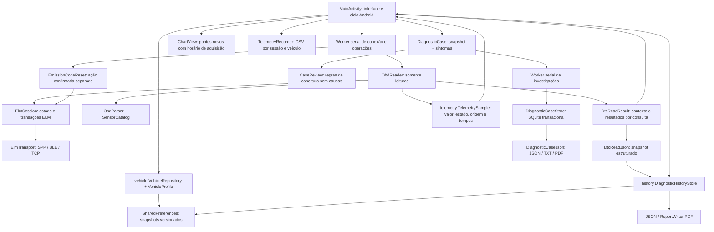

# Arquitetura — BorbaCar Labs 0.6.2

O projeto mantém Android nativo em Java e o pacote `io.rea.obd`, evoluindo o leitor REA OBD 0.2.0. O nome de apresentação passa a BorbaCar Labs; AutoSense AI será o módulo de diagnóstico inteligente. Nenhum modelo de IA está integrado nesta versão.

## Fronteiras e estado

- `ElmSession` é a fonte do estado de conexão. A interface consulta `isConnected()`, sem manter uma segunda flag que possa continuar verdadeira depois do fechamento. Erros de transporte encerram gravação, descartam valores correntes e atualizam a tela.
- `ObdReader` agrupa polling, DTCs, prontidão, VIN/calibração e quadro congelado. Seus casos de uso não possuem operação de escrita. O worker da Activity ainda serializa as chamadas: o leitor não deve ser invocado simultaneamente por vários executores.
- A leitura de DTCs usa `diagnostics.DtcReadResult`: captura imutável com veículo/sessão, origem compartilhada `model.DataOrigin`, MIL e resultado de cada categoria. `ObdParser` é o único proprietário da interpretação das respostas. `DtcFormatter` gera os rótulos da tela; `history.DtcReadJson` persiste os campos estruturados. Códigos podem coexistir em categorias diferentes sem serem fundidos.
- `EmissionCodeReset` contém o serviço de alteração `04`. O botão exige confirmação e o caso de uso verifica novas leituras de velocidade e RPM zero. Não há repetição automática. A implementação física continua sem validação.
- `TelemetrySample` preserva horário UTC, relógio monotônico, origem e estado. Zero é um valor válido. Sem dados, inválido ou não suportado são estados com valor ausente. A expiração visual após 15 segundos é derivada do instante original.
- O gráfico recebe o RPM apenas na aceitação de uma nova amostra válida e recente. Atualizar os rótulos não produz pontos; uma leitura vencida não ganha um horário novo.
- A lista de sensores é capturada na thread da interface antes do envio ao worker. Evita-se ler uma coleção mutável da UI durante a criação do lote em outra thread.

## Persistência e migração

`VehicleRepository` usa `vehicle_store_v2`, migrando `vehicle_store_v1`/`vehicles` sem apagar os originais. Persiste `VehicleRecord` com revisão e proveniência por atributo; a API antiga retorna a projeção `VehicleProfile` preservada para UI/casos. Uma instalação nova começa vazia. Os [contratos de veículos](CONTRATOS-DE-VEICULOS.md) detalham edições, desconhecidos e limites da migração. `DiagnosticHistoryStore` continua usando `diagnostic_history_v1`. Ambos gravam snapshots em SharedPreferences e verificam o resultado da gravação.

`vehicle.catalog` é separado do transporte e da compatibilidade. Sua base embarcada continua vazia, mas alimenta a cobertura e as opções do novo editor. `ui.GarageScreen`, `ui.VehicleEditor` e `ui.UiKit` extraem a apresentação da Garagem da Activity. `VehicleDraft` mantém mudanças em memória até salvar. O host conserva o bloqueio de perfil durante conexão/demonstração e valida novamente ao salvar. A [especificação do catálogo](CATALOGO-DE-VEICULOS.md) descreve ingestão e limites. `CompatibilityEvidence` continua apenas um contrato em memória, sem novas alegações de suporte.

Novas capturas na UI congelam `VehicleRecord` no esquema de caso 4, junto à projeção antiga. `DiagnosticCaseJson` mantém os ramos 1/2/3 e gera a análise 4 com o motor 3 sobre a projeção, acrescentando `VehicleProfileReportV1` para metadados. O formato `vehicle-profile-1` é separado dos rótulos editáveis da UI. SQLite físico permanece 1; não houve regravação de casos existentes. Builder antigo continua disponível em esquema 3. JSON/TXT/linhas de PDF dos casos novos preservam os metadados do snapshot, sem buscar o perfil atual. Os [contratos](CONTRATOS-DE-VEICULOS.md) detalham essas fronteiras.

As chaves antigas `vehicles`, `history` e `garage_seeded` são preservadas para rastreabilidade. As migrações são idempotentes. Perfil antigo não reconhecido mantém nome/observações, com campos técnicos desconhecidos. Relatórios anteriores não possuíam ID de veículo e são migrados explicitamente sem associação; selecionar o Cobalt não os atribui a ele.

Dados malformados ou uma versão de esquema desconhecida produzem aviso, sem sobrescrever silenciosamente o conteúdo de origem. A migração não altera os CSVs antigos. Exportações novas usam colunas adicionais de veículo, adaptador, sessão e estado; importadores devem ler o cabeçalho.

Relatórios novos têm ID, `vehicle_id`, snapshot do nome, data UTC e indicador de simulação. A retenção é de 50 relatórios por escopo. Excluir um histórico afeta o perfil selecionado; remover um perfil preserva seus relatórios na área de perfis removidos. Trocar ou editar perfil é bloqueado durante conexão, demonstração ou gravação para preservar o contexto da coleta.

Em 0.3.1, os relatórios novos acrescentam `dtc_read` com esquema 1. Leitura positiva vazia, NO DATA, negativa, inválida e erro de transporte são estados distintos. Após perder o transporte, consultas restantes ficam não executadas. A estrutura antiga do relatório é mantida como saída de compatibilidade; registros anteriores são preservados sem fabricar observações, horários ou identidade de ECU.

## Coleta e arquivos

A coleta funciona com o Painel visível e a Activity em primeiro plano. Ao mudar de aba, um aviso informa que a gravação está pausada. Não há serviço em segundo plano nem preenchimento artificial dos intervalos sem leituras.

O CSV registra tempos de aquisição de valores e tempos de classificação dos estados sem valor, com `simulated`, `vehicle_id`, `adapter`, `session_id` e `status`. Não mistura origens real e simulada. O arquivo é limitado a 10 MiB por sessão; a referência ao último CSV é preservada e só é restaurada se apontar para a pasta de registros do próprio app.

VIN é consultado e apresentado, mas não sincronizado nem persistido automaticamente em perfis. Não há cliente de IA, backend ou envio automático de telemetria. A permissão INTERNET dá suporte ao adaptador TCP.

## Separações ainda pendentes

A Activity continua responsável por widgets, permissões, ciclo de vida, agendamento e composição de relatórios. Uma extração futura do controlador completo deve preservar a serialização e a propriedade da conexão, usando os testes atuais como regressão. Não foram criados módulos vazios para IA ou laboratório.

A origem escalar das leituras é o veículo, sem identificação de ECU: o parser usa headers ELM desabilitados e a primeira resposta correspondente. Compatibilidade específica GM, ABS, airbag e outros módulos permanece desconhecida.

## Investigações na 0.4.0

`DiagnosticCaseBuilder` recebe somente valores imutáveis. `DiagnosticCase.Sample` atribui identidade de veículo e sessão a cada amostra já tipada; veículo, sessão e origem precisam coincidir com os DTCs. O snapshot é tomado antes da consulta de DTCs; não afirma que a telemetria e os códigos foram medidos simultaneamente. Idade é calculada por UTC em relação ao fim da captura de DTCs, com limiar de apresentação de 15 s. Na reabertura, os dados são sempre históricos; não se compara relógio monotônico de outra execução.

`CaseReview` é uma revisão determinística de cobertura `coverage-1`, com códigos, estados, lacunas e verificações de coleta. Não contém causas técnicas, inferência de modelo ou ligação ao transporte. A hipótese e as fontes técnicas são arrays vazios. Sintomas são explicitamente declarados; seu texto não vira comando ou fato medido.

`DiagnosticCaseStore` usa `diagnostic-cases.db`, esquema 1. A chave primária é `(case_id, revision)`. Cada gravação confere a revisão anterior e a impressão digital dos fatos, dentro de uma transação. Sintomas e data da revisão podem mudar; as medições, o perfil histórico e a sessão não. A consulta confere checksum do documento, fingerprint da entrada e consistência dos índices. O algoritmo `canonical-json-sha256-v1` ordena chaves de objetos, preserva ordem dos arrays e usa SHA-256; serve à detecção de corrupção, não como assinatura de autoria.

A versão atual do documento é aceita somente com a revisão de cobertura conhecida; mudanças futuras de regras exigirão migração explícita, sem reinterpretar silenciosamente resultados salvos. Corrupção ou versão desconhecida geram aviso e preservam o banco. Não se convertem relatórios legados em casos. Novos relatórios têm `investigation_seed` com o snapshot necessário; a relação dos casos usa `dtc_read.capture_id`, inclusive quando há várias investigações para a mesma captura.

O executor de investigações tem vida de processo, serializa I/O e não compartilha o executor ELM. Uma Activity recriada consulta o banco depois das gravações/fechamento do proprietário anterior; esse comportamento é testado com uma escrita enfileirada durante a recriação. A tela filtra por perfil e mantém uma área de perfis removidos. Remover perfil não remove casos; excluir um caso exige confirmação e afeta todas as suas revisões. Exportações usam o documento validado; JSON e TXT foram exercitados em simulação, incluindo cancelamento, restauração da exportação e cópia ao destino. O PDF usa `PdfDocument`, indisponível neste ambiente de testes; precisa de ensaio Android real. O formulário de sintomas não tem salvamento automático de rascunho.

Prontidão e quadro congelado permanecem ferramentas separadas: o caso grava `NOT_COLLECTED`, sem inferir associação entre quadro e código. Não se extraem dados a partir do texto da interface. Esta parte de D02/U01 continua pendente.

## Coleta complementar e esquema 2 — 0.5.0

`SupplementalReadResult` representa a consulta de prontidão 0101 e cinco PIDs fixos do serviço 02, quadro 00. `ObdReader.readSupplement` é somente leitura e usa o mesmo worker serial ELM. `ObdParser.decodeReadiness` e `decodeFreezePid` compartilham o framing/classificação e a conversão numérica existentes; não há um segundo conversor. O monitor é derivado dos bytes A/B/C/D em `ReadinessBits`, reutilizado também pela apresentação avulsa anterior.

Cada resultado preserva estado e janela de consulta, múltiplas observações com IDs e horário de coleta. Negativas conservam serviço/NRC; resposta inválida não cancela as outras consultas; falha de transporte marca o restante NOT_READ com horários nulos. O bitmap do serviço 01 não é usado para declarar suporte ao quadro. Respostas não identificam ECU; valores de diferentes PIDs não são unidos numa ECU presumida. `associated_dtc` e `frozen_at` permanecem nulos.

O botão complementar só opera após DTCs, com perfil/sessão/origem correspondentes. Uma nova leitura de DTCs ou desconexão limpa o complemento. Após falha de transporte, o resultado parcial permanece anexável à leitura retida. A gravação explícita de um caso congela o complemento; ele não é incorporado automaticamente ao relatório de DTCs anterior. Casos criados de um relatório antigo não recebem dados de outra sessão.

`DiagnosticCase` preserva `schemaVersion` e suplemento opcional. Novos casos são esquema 2; documentos antigos são decodificados e conferidos como esquema 1 sem reanálise com regras novas. `CaseReview` mantém a reprodução de `coverage-1` para esquema 1 e usa `coverage-2` para esquema 2. A revisão de sintomas preserva a versão e o snapshot. O esquema físico SQLite continua 1, pois armazena documentos versionados; nenhuma migração destrutiva foi adicionada.

`SourceReference` e `KnowledgeRepository` mantêm `protocol-links-1`: metadados/link para ELM e CSS Electronics, escopo genérico e distribuição somente de metadados. Novos documentos com complemento incluem `protocol_sources` separados de `sources_used` (causas mecânicas, ainda vazio). O catálogo de conversão continua em SensorCatalog/ObdParser. Os registros e regras versionados precisam ser preservados quando versões futuras forem acrescentadas, pois sua reprodução participa da validação de integridade.

## Catálogo e roteiro — esquema 3 / 0.6.0

`DtcCatalog` fixa `generic-dtc-1`, cinco `DtcDefinition` e referências de significado. Resumos factuais originais são separados dos metadados de fonte. `repair_applicability=NOT_ESTABLISHED` impede interpretar um documento de outro motor/veículo como procedimento confirmado. A lista de protocolo anterior não foi alterada, preservando documentos 2.

`RuleDiagnosticEngine` aceita somente casos esquema 3 e produz `DiagnosticResult`: definições com IDs de evidências, perguntas/verificações tipadas, lacunas, limitações e fontes de significado. Reutiliza `CaseReview` como camada de cobertura, sem interpretar seu texto como fatos. Não possui transporte, comandos livres ou modelo. Não gera hipóteses causais nem probabilidades.

`DiagnosticResultJson` codifica a análise 3 com `investigation-1` e catálogo fixo, mantendo `definition_sources` separado de `sources_used` (causas, vazio). A versão original de `DiagnosticCaseJson.document` é conservada para esquemas 1/2. O builder cria esquema 3; a revisão de sintomas preserva a versão de origem. O esquema físico SQLite continua 1. Além de caso/revisão e fingerprint da entrada no documento, o relatório exige o mesmo snapshot imutável recebido pelo motor, evitando combinar um resultado com outra entrada de IDs iguais.

A interface exibe o significado nas cartas de DTC, permite busca offline no catálogo e inclui o roteiro nas exportações JSON/TXT. Códigos desconhecidos não são normalizados para o código conhecido mais próximo. Os fixtures originais 0.4/0.5 são lidos e revisados sem sobrescrever análises anteriores. A inspeção de fontes não equivale a ensaio físico nem a revisão mecânica independente.

## Painel Foco (0.6.3 / 4.4)

DashboardState calcula uma visão imutável dos sinais; DashboardScreen renderiza essa visão sem coletar. ChartView usa somente pontos recebidos e mantém seleção/lacunas. MainActivity continua proprietária da aquisição, gravação e ciclo de vida. A guarda de escrita impede CSV durante pausa. TelemetryRecorder expõe seu ID sem alterar o formato. Persistência e transporte não mudaram. Contratos detalhados em [PAINEL-FOCO.md](PAINEL-FOCO.md).

## Navegação R1a (0.6.4)

NavigationState conserva IDs de telas legadas, valida restauração e define aba ativa/retorno. HomeScreen apresenta somente dados fornecidos pelo host. MainActivity move a apresentação antiga de relatórios/investigações para historyScreen; não modifica os repositórios. Ao vivo conserva ID 0, mantendo as guardas de aquisição e CSV. Hoje (4) é a entrada nova; Histórico (5), Garagem (2), Diagnóstico (1) e Ajustes (3) preservam o escopo de suas ações. Detalhes em VALIDACAO-R1A.md.

## Aparência e histórico R1b (0.6.5)

ThemePalette resolve a preferência local appearance/theme (system/light/dark) e as cores por contexto. UiKit traduz os tokens legados para a paleta; a Activity inicializa cores e estilo antes de renderizar. Formulários e gráficos seguem a mesma paleta. A troca manual recria a Activity somente sem sessão ativa; não foi introduzido serviço de aquisição nem modificado o transporte. A paginação altera apenas historyLimit, preservado no Bundle; os registros e exportadores continuam com os formatos anteriores. Detalhes em VALIDACAO-R1B.md.

## Experiência 0.6.6

Motion e VehicleArtwork são apresentação sem acesso às leituras. ConnectionScreen organiza entradas existentes. DiagnosisScreen apresenta estados estruturados. application/GuidedReadController coordena dois grupos por uma fonte injetada; a Activity preserva guarda de sessão e executa no worker. diagnostics/CaptureComparison compara conjuntos por serviço somente quando os resultados são comparáveis. Nenhum transporte/parser/exportador recebe mudança de formato.

## Diário 0.6.7

JournalEntry/FuelSummary são domínio Java, JournalJson é o contrato v1 e JournalStore mantém revisões em banco SQLite separado. JournalController serializa IO, restaura exportação pendente e aplica guardas de perfil/demonstração. JournalEditor conserva rascunho e bloqueia edição durante gravação. A rota 6 pertence a Histórico; nenhuma rota anterior mudou. Não há aquisição OBD no diário.

Atualização 26/10/2026 — 0.6.8: revisão de densidade/navegação Foco, destinos sem atalhos repetidos, opções em detalhes, coleções separadas no Histórico e primeira base factual MY19 (16 configurações). Ver FOCO-0.6.8.md e CATALOGO-MY19-0.6.8.md. Sem mudança em transportes, bancos ou formatos históricos.
