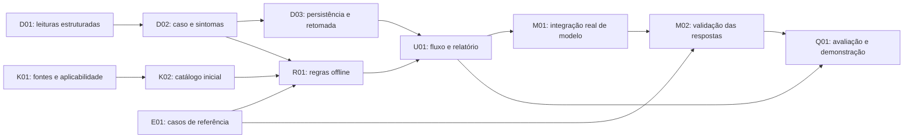

# Plano de execução — do leitor ao diagnóstico inteligente

> Plano anterior preservado. A prioridade atual está em [Reformulação de produto — outubro de 2026](REFORMULACAO-PRODUTO-2026-10.md). As funcionalidades propostas ali ainda não estão na APK 0.6.3.

Atualizado em 20/10/2026. Base atual: BorbaCar Labs 0.6.0. D02 está implementado no escopo prontidão 0101/quadro 00 de cinco PIDs; D03 e fluxo inicial U01 preservados. K01/K02 incluem cinco significados genéricos e referências; R01/U01 recebem roteiro offline. Causas e procedimentos aplicáveis continuam pendentes. Validação em `VALIDACAO-0.6.0.md`. D01 permanece entregue em 0.3.1.

## Resultado esperado para o MVP

Um usuário seleciona o veículo, faz uma leitura ou abre um cenário simulado, informa sintomas e recebe um caso de diagnóstico salvo. O resultado distingue observações, dados ausentes, hipóteses, verificações sugeridas, fontes e limitações. Sem internet, o caso e a análise por regras continuam acessíveis. Quando houver integração real de modelo, seu uso e seus limites serão identificados.

O MVP acadêmico não exige cobertura completa do Cobalt nem reprodução integral do Carista. Exige um fluxo demonstrável, rastreável e avaliado. Compatibilidade específica permanece desconhecida até haver documentação aplicável ou ensaio identificado.

## 1. Ponto de partida e primeira dependência

A versão 0.3.0 já possui transporte, sessão, parser, perfis, amostras tipadas, histórico por veículo e regressões de estabilidade. A validação registrada compreende 517 verificações Java e 13 testes Android simulados; não é um ensaio em veículo.

Foram identificadas quatro lacunas na base 0.3.0 antes de um motor de diagnóstico:

1. `ObdReader.Codes` devolvia listas de texto com código e rótulo. **Resolvido em D01:** a versão 0.3.1 usa `DtcReadResult` e observações tipadas, com resultados independentes por serviço, contexto e horários.
2. `readiness()`, `vehicleInfo()` e `freezeFrame()` devolvem texto. A apresentação pode permanecer, mas os fatos que a geram precisam de uma representação consultável.
3. `TelemetrySample` tem qualidade e horários, mas não carrega identidade de veículo/sessão. O caso deve capturar esse contexto e validar a associação, sem recuperar amostras globais de outro momento ou perfil.
4. O histórico salva relatórios, mas não um caso reabrível com sintomas, entrada congelada e versões de conhecimento/regras.

**D01 entregue; D02 implementado para DTCs, sintomas e telemetria contextual; D03 implementado. A 0.5.0 completa prontidão/quadro estruturados; a 0.6.0 acrescenta significados e roteiro; próximo bloco: contrato/configuração de modelo e fontes de causas aplicáveis, sem presumir integração real.** Preservar categorias, ausência de resposta e leituras parciais antes de acrescentar descrições ou hipóteses. Não extrair fatos analisando frases já traduzidas para a interface.

## 2. Entregas e dependências

K01 e E01 podem ser preparados enquanto os contratos são estruturados. O analisador de modelo depende dos contratos e do fluxo offline. Não precisa de transporte, sessão ELM ou operação de alteração.

### Entrega A — casos de diagnóstico confiáveis

| ID | Trabalho e arquivos | Aceitação | Verificação |
|---|---|---|---|
| D01 — entregue em 0.3.1 | `ObdReader.java`, `diagnostics/DtcObservation.java`, `diagnostics/DtcReadResult.java`, `DtcFormatter.java` e `MainActivity.scan()` implementados; histórico recebe `dtc_read` | Código separado do texto; categorias preservadas; cada consulta tem resultado próprio; resposta positiva vazia difere de serviço indisponível; falha parcial preserva os fatos obtidos | Cenários de transporte roteirizado e integração Android passaram; nenhum serviço `04` enviado |
| D02 — implementado no escopo 0.5.0 | Caso/sintomas/telemetria contextual e `SupplementalReadResult`: prontidão 0101, quadro 00 com cinco PIDs e associação DTC desconhecida. Esquema 2 sem alterar documentos antigos | Caso imutável, ligado a perfil/sessão, com origem e horários; campos desconhecidos permanecem ausentes; idade das leituras e condições declaradas são explícitas | Mistura de perfis/origens rejeitada; dado antigo não é atual; sintomas não viram evidência medida; quadro sem associação DTC confirmada mantém associação desconhecida |
| D03 — implementado na 0.4.0 | SQLite em `DiagnosticCaseStore`, documentos/fingerprints em `DiagnosticCaseJson`; relatórios vinculam investigações por ID da captura DTC | Salvar e reabrir caso sem rede; preservar relatórios 0.3.0; manter registros antigos sem associação; excluir um perfil/caso não afeta outro | Migração idempotente, corrupção sem sobrescrita, retomada após reiniciar e exclusão por escopo |

A 0.4.0 entrega esse fluxo intermediário: caso/sintomas, revisões, retomada, exclusão por escopo e JSON/TXT verificados em simulação. Não houve conversão de texto legado em medições; relatórios novos preservam um snapshot para iniciar investigações. A 0.5.0 acrescenta prontidão/quadro tipados com estado individual, sem atribuir ECU/código por suposição. Validação real do PDF e do adaptador continua pendente.

### Entrega B — conhecimento e diagnóstico offline

| ID | Trabalho e arquivos | Aceitação | Verificação |
|---|---|---|---|
| K01 — metadados iniciais na 0.5.0 | `SourceReference` e `KnowledgeRepository` versionam referências genéricas de protocolo, consulta/escopo e distribuição somente de links/metadados. Documentos e causas não são redistribuídos; fontes mecânicas ainda pendentes | Fonte com identificação, versão, localização, permissão/licença conhecida ou pendente e aplicabilidade. Só conteúdo liberado para o uso previsto entra no pacote distribuível | Entrada sem origem não é aprovada; documento de outro motor/mercado não vira fonte confirmada para o perfil |
| K02 — significados iniciais na 0.6.0; causas pendentes | Referência dos 23 PIDs e `generic-dtc-1` com cinco resumos factuais, origem/escopo e reparo não estabelecido. Sem duplicar fórmulas ou importar procedimentos de outras configurações | Reutilizar fórmulas atuais; não duplicá-las num segundo parser. Descrição e possíveis causas só entram após fonte aplicável e revisão. Código desconhecido continua visível sem descrição inventada | Referências resolvidas, unidades compatíveis, ausência de causas quando não há suporte; fórmulas continuam passando nos testes existentes |
| R01 — roteiro inicial na 0.6.0; hipóteses pendentes | `RuleDiagnosticEngine`/`DiagnosticResult`: `investigation-1`, definições com evidências, lacunas e perguntas/verificações tipadas. Reutiliza cobertura anterior; não confirma causa/peça | Produzir observações, lacunas, hipóteses documentadas quando cabíveis e próximos passos de leitura/verificação. Código isolado não confirma peça defeituosa; ausência de códigos não confirma saúde total | Cenários suficientes, insuficientes e contraditórios. Mesmo caso e mesmas versões produzem resultado determinístico |
| U01 — catálogo/roteiro na 0.6.0 | Aba Falhas inclui criação, detalhes, revisões, exclusão e exportações JSON/TXT; PDF usa `ReportWriter`, pendente de ensaio real; inclui consulta de significados e roteiro no caso/relatório; sem análise causal completa | Exibir “Dados observados”, “Informações ausentes”, “Hipóteses”, “Verificações” e “Fontes”. Identificar análise por regras. Salvar resultado ligado à entrada e às versões | Navegação Android, restauração, isolamento, exportação e consulta offline. PDF/JSON contêm os mesmos fatos e o veículo correto |

Cobertura inicial orientada por casos de referência, não pelo maior número de códigos. Começar com três a cinco cenários técnicos revisáveis; exemplos do modo demonstração não autorizam automaticamente suas descrições ou causas. A lista final de DTCs dependerá das fontes que puderem ser verificadas.

### Entrega C — integração de modelo e avaliação

| ID | Trabalho e arquivos | Aceitação | Verificação |
|---|---|---|---|
| E01 — base estrutural ampliada; revisão mecânica pendente | Casos de referência em `tests/evaluation/`, com entradas, fatos esperados, afirmações proibidas e fontes | Separar avaliação de regras da avaliação de modelo. Registrar versão da referência e estado da revisão técnica | Cenários da seção 4; conjunto que não dependa do próprio modelo para decidir se uma resposta está correta |
| M01 | Propor `ai/DiagnosticAnalyzer.java` e adaptador configurável; gateway mínimo se o provedor for remoto | Modelo real recebe contexto mínimo e fontes recuperadas. Consentimento antes do envio; chave fora da APK. Nenhum acesso ao leitor ou à ação de apagar códigos | Requisição sanitizada, falha de rede, tempo limite, cancelamento e resposta tardia. Identificação explícita do provedor/modelo efetivamente usado |
| M02 | Propor `ai/DiagnosticResultValidator.java` e contrato versionado | Rejeitar formato inválido, IDs de evidência/fonte inexistentes e sugestões de execução direta no veículo. Uma referência existente, sozinha, não comprova que o texto seja sustentado por ela | Casos de resposta inventada, fonte inadequada, instrução embutida em documento e campos extras perigosos; avaliação técnica das afirmações |
| Q01 | Consolidar relatório, avaliação, manual e roteiro demonstrável | Fluxo completo reproduzível; uso de modelo real distinguido de regras e simulação; falha do modelo mantém caso/regras disponíveis | Rodar regressões, avaliar os casos, abrir exportações e registrar limitações. Ensaio físico separado quando houver hardware |

A escolha do provedor ainda está aberta. Se houver inferência remota, a proposta é um gateway pequeno com configuração e segredo no ambiente de execução; não exige construir conta de usuário, sincronização ou backend amplo. Um modelo local só será escolhido após medir viabilidade no equipamento disponível. Não haverá simulação apresentada como integração real de IA.

## 3. Fluxo de uso proposto

1. Confirmar perfil selecionado e origem: veículo ou demonstração.
2. Ler DTCs e mostrar resultados por categoria, inclusive os serviços que não responderam.
3. Abrir “Investigar leitura”, aproveitando o snapshot daquele caso.
4. Informar sintomas e condições opcionais: quando ocorre, temperatura percebida/condição informada, frequência e observações. Não bloquear o fluxo por campo que o usuário desconhece.
5. Mostrar quais dados atuais/quadro estão presentes e quais estão ausentes ou antigos. Leitura complementar é uma ação explícita e restrita ao mesmo perfil/sessão.
6. Executar regras offline e apresentar fatos, lacunas e verificações.
7. Quando disponível e consentido, solicitar análise do modelo para esse mesmo caso.
8. Validar e salvar o resultado, com fontes e identificação de uso de regras/modelo.
9. Reabrir ou exportar o caso. Uma nova leitura cria nova revisão, sem sobrescrever os fatos históricos.

Na 0.4.0, os passos 1–4, 6 (somente cobertura), 8 (regras de cobertura) e 9 estão disponíveis. Na 0.5.0, o passo 5 anexa prontidão/quadro ao novo caso mediante coleta explícita na mesma sessão. O passo 7 depende de M01/M02. O botão de apagar códigos continua uma ação separada. Não faz parte das etapas automáticas de investigação. O caso é um registro histórico: amostras antigas podem ser analisadas como históricas, mas nunca apresentadas como leitura atual.

## 4. Matriz inicial de avaliação

| Caso | Situação | Resultado obrigatório |
|---|---|---|
| V01 | Código sem definição técnica disponível | Exibir o código; informar a ausência de definição; não inventar causa |
| V02 | Uma categoria retorna zero códigos e outra não responde | Registrar a primeira como vazia confirmada e a segunda como desconhecida |
| V03 | Sem resposta da ECU | Mostrar falha/ausência de comunicação; não inferir falha mecânica |
| V04 | PID não suportado ou sem dados | Valor ausente com motivo; nunca substituir por zero |
| V05 | Zero medido validamente | Preservar zero como leitura válida |
| V06 | Amostra antiga ou de sessão anterior | Contextualizar como histórica; não atribuir frescor pela abertura do caso |
| V07 | Dados de dois veículos ou origens real/simulada misturados | Rejeitar a combinação e informar a inconsistência |
| V08 | Fonte de configuração diferente ou aplicabilidade desconhecida | Não apresentá-la como especificação confirmada daquele veículo |
| V09 | Dados insuficientes/contraditórios | Explicitar lacunas e solicitar verificações que reduzam incerteza |
| V10 | Mesmo caso reapresentado ao motor de regras | Resultado reproduzível com as mesmas versões |
| V11 | Modelo fora do esquema ou citando ID inexistente | Rejeitar a resposta e preservar a análise offline |
| V12 | Serviço de modelo indisponível | Informar indisponibilidade, manter histórico/regras e não fingir resposta de modelo |
| V13 | Sintoma/documento contém instruções dirigidas à IA | Tratar como dados; não alterar as regras da aplicação nem abrir acesso ao veículo |
| V14 | Resposta chega depois de mudar de caso | Associar pelo ID original ou descartar da tela atual; não contaminar outro veículo |
| V15 | Abrir, editar sintomas e exportar caso | Fatos originais preservados; revisão, veículo e fontes rastreáveis |
| V16 | Diagnóstico comum | Nenhum envio de comando de alteração; o analisador não recebe referência de `ElmSession` |

Os IDs desta matriz são cenários, não IDs das tarefas do backlog. Uma resposta pode passar na validação de JSON e ainda conter erro técnico. A avaliação deve verificar sustentação das afirmações, relevância das hipóteses, tratamento da incerteza e adequação dos próximos passos. Percentuais de confiança não serão apresentados como probabilidades sem calibração.

## 5. Condições para liberar cada entrega

- Regressões existentes continuam passando; novas regressões cobrem o comportamento acrescentado. Atualizar a contagem somente após executar os testes.
- Perfil, origem e instante permanecem rastreáveis do caso ao relatório. Nenhum dado é inventado para completar o formulário.
- Versões de esquema, catálogo e regras são salvas. Migrações preservam relatórios anteriores e identificam explicitamente o que não era conhecido.
- Fontes novas são verificadas antes de entrar na base. Uma URL em planejamento não equivale a fonte recuperada ou aprovada.
- Leitura e operação de alteração continuam separadas. O analisador trabalha com valores e referências, sem acesso a comandos.
- O resultado informa se foi gerado por regras ou por modelo. A falha de um serviço remoto não elimina a utilidade offline.
- APK com pacote/assinatura de continuidade; documentação e hashes correspondentes. Publicação externa é uma etapa própria, não consequência automática do build.

## 6. Sequência sugerida até a apresentação

As janelas abaixo são estimativas de organização para a meta acadêmica de 05/11/2026, não compromissos de conclusão sem verificar capacidade e impedimentos.

| Janela | Prioridade | Entrega demonstrável |
|---|---|---|
| 20–22/10 | D01–D03 | Caso estruturado, sintomas e retomada local; começar K01/E01 |
| 23–25/10 | K01–K02 e R01 | Catálogo pequeno com origem e análise offline dos casos selecionados |
| 26–28/10 | U01 e E01 | Tela e relatório completos; avaliação offline |
| 29–31/10 | M01–M02 | Integração real de modelo, caso haja configuração/fontes, e validação de suas respostas |
| 01–03/11 | Q01 | Regressões, avaliação, exportações e documentação; ensaio físico se disponível |
| 04–05/11 | Estabilização | Correções prioritárias e demonstração, sem expansão de escopo |

Se houver atraso, reduzir a quantidade de códigos, fontes e componentes visuais. Preservar o fluxo completo, a avaliação e a identificação correta das limitações. Se o modelo não puder ser integrado, registrar o objetivo de IA como pendente; não rebatizar regras offline como IA para aparentar cumprimento acadêmico.

## 7. Dependências ainda abertas

| Dependência | Trabalho que pode continuar | O que depende de resolução |
|---|---|---|
| Modelo de adaptador e Android não informados | Contratos, migração, testes simulados e diagnóstico offline | Compatibilidade física e ensaio real |
| Motor/transmissão/mercado desconhecidos | Identidade parcial e regras genéricas aplicáveis | Especificações e procedimentos específicos da configuração |
| Fontes técnicas ainda sem revisão por entrada | Estrutura do catálogo e cenários sem definição | Inclusão de descrições/causas/procedimentos específicos |
| Provedor e configuração de modelo não definidos | Contrato, validação, gateway de teste e regras offline | Inferência real, custos/latência medidos e envio consentido |
| Casos sem revisão técnica independente | Testes de formato, rastreabilidade e falhas | Avaliação da qualidade mecânica das hipóteses e recomendações |

Nenhuma dessas dependências será preenchida por suposição. Elas não impediram D01, os casos/revisões de D02/D03 nem a revisão de cobertura offline. As hipóteses mecânicas e a integração de modelo continuam dependentes das etapas técnicas próprias.

## 8. Expansões preservadas no roadmap

Após estabilizar o MVP: controlador completo de sessões e coleta ajustável; comparação de logs; layouts de painel; alertas com limites fundamentados ou personalizados; recuperação ampliada de documentos; novos veículos e perfis de compatibilidade; laboratório de análise somente leitura.

Serviços e codificação específicos GM, ABS/airbag, TPMS e calibração continuam sujeitos a documentação e validação próprias. Pesquisa de arquivos de calibração e qualquer escrita futura não entram no caminho crítico da demonstração acadêmica.

Os detalhes dos contratos estão em [CONTRATOS-DE-DIAGNOSTICO.md](CONTRATOS-DE-DIAGNOSTICO.md). D01 substituiu a representação na origem; a 0.4.0 consome esses snapshots em casos sem alterar relatórios anteriores. A continuidade agrupa tarefas independentes, separando fontes/compatibilidade e validação física que exigem precisão específica.
